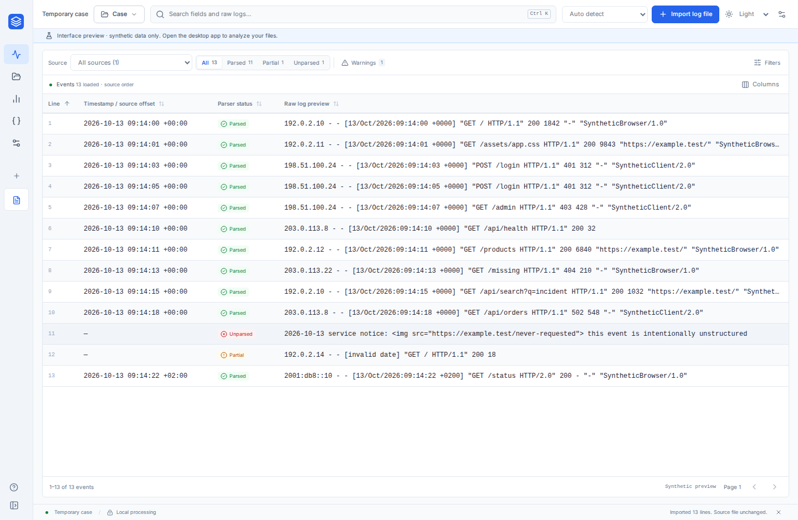
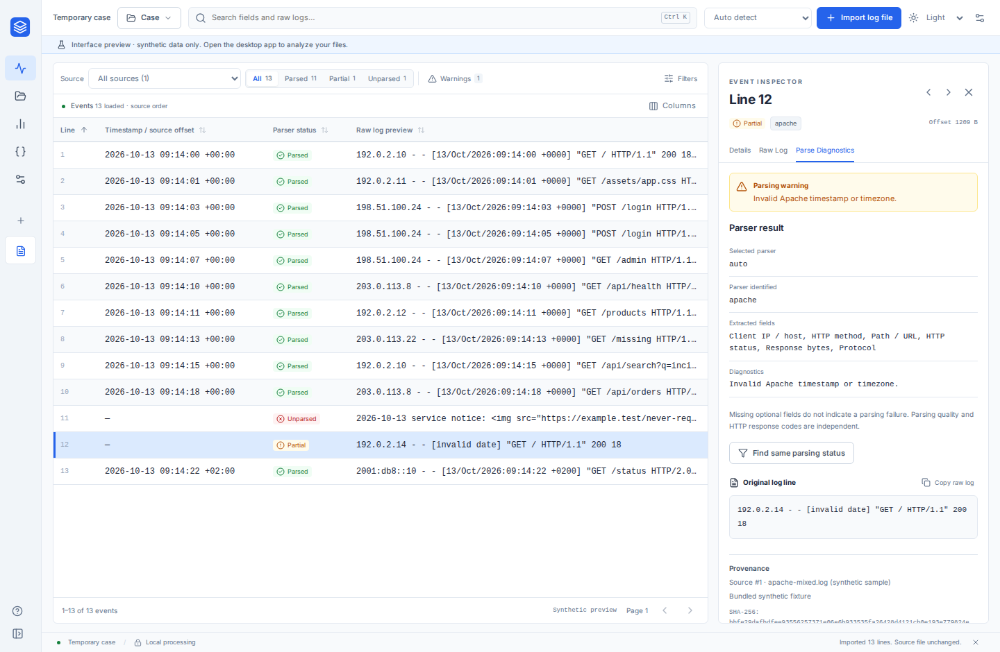
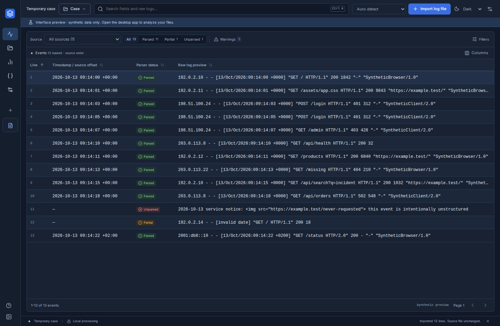

# Minimal log workspace — MVP 1 (v0.2.1)

Pre-merge feedback on 2026-10-13 requested shorter download paths, an icon consistent with the application, and a simpler interface that starts with parsing and reading logs.

## Delivered behavior

- One compact header contains the case menu, search, reader selection and import button. The sidebar starts collapsed; an explicitly saved preference is retained.
- Explore starts directly with source/parsing/warning filters and the virtualized event table. Statistics cards, HTTP summaries and timeline no longer appear above the logs.
- The existing aggregates and timeline are available in Statistics. Selecting an interval returns to matching logs.
- Additional reader, timestamp, JSON, search-field, exact-field and UTC-range controls open under Filters. Active filter chips and Reset remain visible with that panel closed.
- Default columns show line, timestamp, parsing status and raw content. Multiple-source cases additionally identify the source. Columns remain configurable; old default preferences migrate to the compact layout, while custom selections survive.
- Case save/open/new actions are grouped in the Case menu. The event inspector still opens next to the logs, or overlays them at the minimum width.
- A blue layered-log SVG is the source for the sidebar, favicon and packaged launcher icons. Regenerate the PNG/ICO assets with `npm run tauri -- icon public/mark.svg --output src-tauri/icons`.
- Download files are staged together before artifact upload. The ZIP root contains the Linux `.deb` and executable, or the Windows setup executable. CI rejects missing/unexpected files or nested staging directories.

Version 0.2.1 changes presentation and packaging without changing the case schema or readers. MVP 2 has not started.

## Validation

Measured in Chromium against the actual application with its labeled synthetic preview. Production desktop mode does not show the 28 px preview banner.

| Window     | First log row, Y | Table height | Share of window height |
| ---------- | ---------------- | ------------ | ---------------------- |
| 1440 × 940 | 205 px           | 691 px       | 74%                    |
| 1280 × 720 | 205 px           | 471 px       | 65%                    |
| 1000 × 650 | 205 px           | 401 px       | 62%                    |

The document has no horizontal or vertical overflow at these sizes. Regression checks require the first row at or above 220 px and the table above 60% of the viewport height; they also verify the compact default, migrated/custom columns, hidden secondary controls, visible active chips and menu closure.

Local checks passed: TypeScript/production build, three preview unit tests, ten Chromium workflows, 27 Rust workspace tests, Clippy with warnings denied and Linux debug `.deb` packaging. Native Linux save/open dialogs, real Nginx/JSON imports, persisted reopening, combined filters and inspector provenance passed. The package's three launcher icons match the generated assets. The native test now waits for visible X11 dialog windows before focusing them.

Linux/Windows release tests, packaging and the downloadable ZIP contents are verified through the [MVP 1 workflow](../.github/workflows/mvp-1.yml). See its current run for platform results. Interactive Windows testing remains to be performed; no new offline traffic audit or performance comparison was run for this presentation change.

## Screenshots

Actual application captures using synthetic evidence, with optional panels closed by default:

