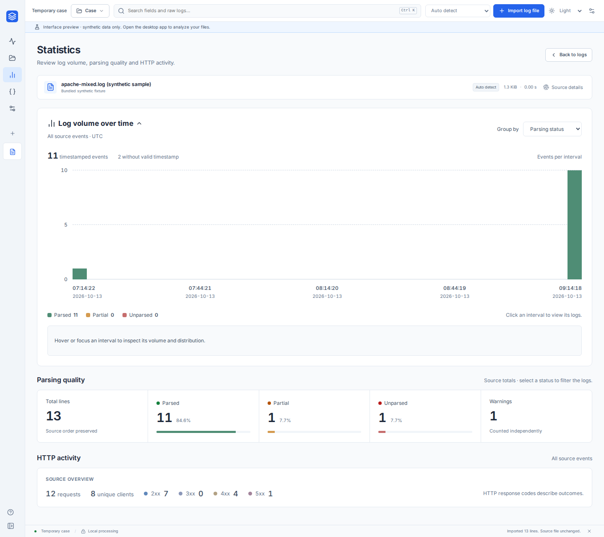
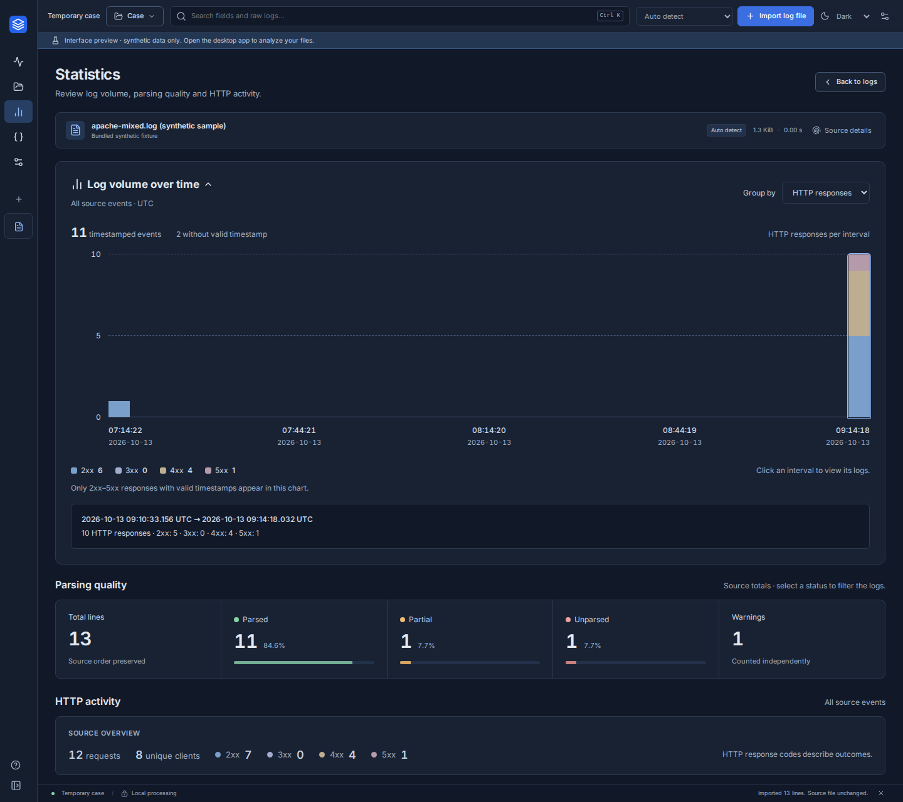

# Statistics readability update

This change improves the MVP 1 Statistics page before MVP 2 development.

The timeline is the main visualization, with a 260 px plot instead of the previous 44 px histogram. Whole-count volume ticks, grid lines and five UTC date/time labels make peaks and quiet intervals easier to compare. Short ranges display milliseconds. Parsing and HTTP distributions have visible legends with counts, including at the minimum desktop width. Hovering or focusing an interval shows its exact UTC bounds and distribution; clicking or pressing Enter returns to the matching logs.

Parsing totals now use larger numbers, labels and proportion tracks. Separate headings distinguish source parsing totals from HTTP aggregates and the timeline, which follow the current filters. Timeline legends count only timestamped events; the HTTP chart additionally covers only 2xx–5xx responses. Missing timestamps, empty results and unavailable statistics remain explicit.

The Statistics content scrolls within the workspace when needed, keeping the plot at full height on shorter windows. Explore retains its compact default layout.

## Validation

- `npm run build`: passed (TypeScript and production bundle).
- `npm test`: passed, 3 preview tests.
- `PLAYWRIGHT_BROWSERS_PATH=/tmp/dfir-playwright-browsers npm run test:e2e`: passed, 12 Chromium workflows.
- `npm run format:check` and `git diff --check`: passed.
- Statistics checks cover Light/Dark at 1440 × 940, 1280 × 720 and 1000 × 650, plot dimensions, font sizes, legend visibility, access to all counters, and absence of horizontal overflow. Interaction checks cover hover, keyboard activation, matching-event scope, empty results and missing timestamps.
- Rust/native desktop builds and interactive Windows tests were not run for this frontend change. Native readers, queries and case storage are unchanged.

## Screenshots

Actual application captures with the labeled synthetic sample, at 1440 × 1280 to show all sections together. Shorter windows scroll the Statistics content.

