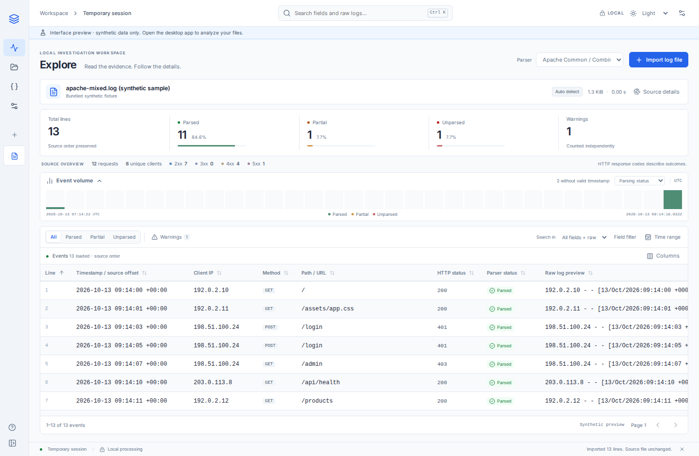
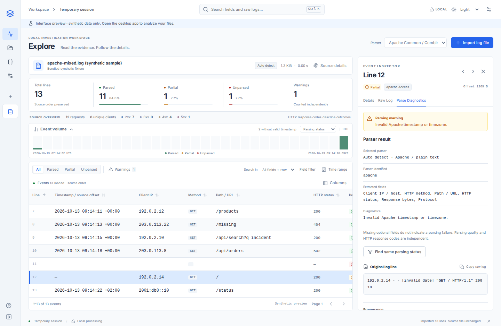
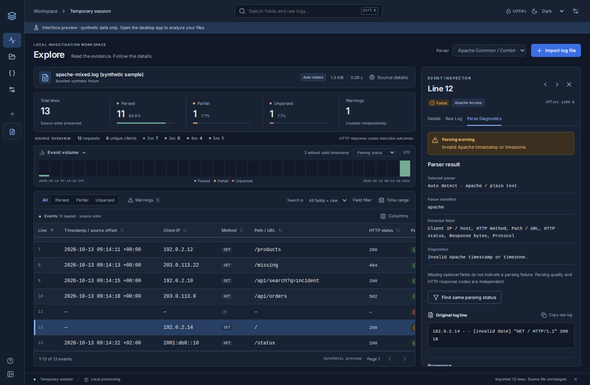

# MVP 0 UI/UX redesign delivery

Recorded on 2026-10-13. The redesign extends the accepted MVP 0 without changing its desktop platforms, parser formats, native import commands, dependencies or local session lifecycle. See the [initial audit and migration decisions](ui-ux-audit.md).

## Audit and retained behavior

The application uses React/TypeScript/Vite inside Tauri 2, with a Rust/DuckDB engine. Existing TanStack Table/Virtual, locally bundled Inter and Lucide are retained. Imports remain buffered, read-only, SHA-256 verified and transactional; cancellation and errors preserve the previous dataset. Original bytes, line order, byte offsets, source timezone offsets, invalid UTF-8 handling and full selected-event details remain available. Queries and details remain suspended during imports. The browser preview remains explicitly restricted to the Rust-generated synthetic fixture.

## Product changes and components

- Slate/blue design tokens and Light (default), Dark and System themes. Appearance preferences persist locally; source content and searches do not.
- Compact source-centered workspace, collapsible sidebar and working Explore/Evidence/Parsers/Settings navigation. Unsupported cases, dashboards and saved-search modules are omitted.
- `WorkspaceChrome` (Sidebar, Topbar, PageHeading), `WorkspaceViews`, `HelpDialog` and `LogSourceHeader` separate navigation and secondary views from query/import orchestration.
- `ParsingSummary` and `ParsingStatusBadge` distinguish three parsing states and independent warnings. Source-wide parsing totals and percentages remain distinct from filtered HTTP statistics.
- `TimelineChart` uses up to 32 real aggregate buckets. Parsing and HTTP views, interval selection and explicit UTC range filters share the engine query. Events without valid timestamps are counted separately. The timeline collapses automatically at short window heights and can be reopened.
- `LogFilterBar` combines literal field/raw searches, parsing status, warnings, one exact field-value filter and UTC bounds. Criteria are visible and removable. No query language is introduced.
- `EventTable` retains 500-row pages and virtual rendering. Columns are configurable and persisted. Sorting operates across all matching events with nulls last; original line order is the default. Keyboard navigation, long-value previews, selected rows and horizontal scrolling are available.
- `DetailPanel` has Details, Raw Log and Parse Diagnostics tabs, full extracted values, copy actions, exact-value filters, same-status filtering, provenance and within-page event navigation. Diagnostic messages come from the engine. Raw text is escaped by React, and invalid UTF-8 bytes remain inspectable in hexadecimal.
- Loading or failed aggregate queries display an explicit pending/unavailable state instead of invented zero statistics.

No dependencies were added. No custom parser editor, new parser format, threat detection, server deployment or service change is included.

## Minimal data and query changes

`ParsedFields` adds `parseStatus`; the temporary DuckDB table stores it. The existing Apache pattern is retained. Required fields are validated independently, preserving valid fields when timestamp/request/status/size validation fails. Matching records with validation failures are Partial; pattern mismatches are Unparsed. Optional Common/Combined fields and valid `-` sentinels do not create Partial results. Unrecognized automatic-mode text is Unparsed without an invented warning. Explicit plain-text mode is Parsed as a successful raw-text read; encoding warnings are independent.

`SourceSummary` adds provenance, parser mode, Partial and Unparsed counts. `parsedEvents` now counts Parsed results (including explicit plain-text reads); `textEvents` remains available for reader attribution. Parsed + Partial + Unparsed always equals total lines. Warnings count records with a non-null engine warning, independently of parsing status, rather than individual sentences in a diagnostic.

`Query` adds optional search scope, parsing status, exact-field filter, UTC range and sort fields with defaults for legacy payloads. Column identifiers are whitelisted enums, and user values are bound parameters. `QueryPage` adds whole-result statistics and bounded timeline buckets. Four recent predicate aggregates are cached independently of sorting/pagination and invalidated only after successful imports. This is session-only state; no persistent schema migration or original file modification occurs.

## Validation

| Check                                                                      | Actual result                                                                                                           |
| -------------------------------------------------------------------------- | ----------------------------------------------------------------------------------------------------------------------- |
| `cargo test --workspace --offline --locked`                                | Passed: 19 Rust tests; native application test targets compile                                                          |
| `cargo clippy --workspace --all-targets --offline --locked -- -D warnings` | Passed, no warnings                                                                                                     |
| `cargo fmt --all --check`                                                  | Passed                                                                                                                  |
| `npm run build`                                                            | Passed: TypeScript and production assets                                                                                |
| `npm test`                                                                 | Passed: 2 Vitest tests                                                                                                  |
| `npm run test:e2e`                                                         | Passed: 7 Chromium workflows                                                                                            |
| `npm run format:check`                                                     | Passed                                                                                                                  |
| Native Linux build and `tests/native_smoke.py`                             | Passed: real Tauri/Rust import, legacy IPC, detail, parsing states, raw search, warnings, global sorting and aggregates |
| Desktop viewport                                                           | Verified at 1440 × 940 and 1000 × 650; table remains usable and inspector closes                                        |
| Windows interactive acceptance                                             | Not executed on this Linux host; platform CI builds remain necessary                                                    |

Fixtures exercise valid Common/Combined records, IPv6, missing optional values, malformed timestamps/HTTP fields, truncated lines, unexpected formats, blank/CRLF/unterminated lines, invalid UTF-8, very long fields, literal injection-like searches, rollback and source mutation. New assertions check exclusive counts, retained Partial fields, missing timestamps, exact/combined filters, global sorting beyond the first 500 rows, aggregate cache invalidation and legacy query compatibility. Browser checks cover escaped HTML, cancellation, scope searches, filters, timeline selection, persisted columns/themes, OS theme changes, keyboard navigation and exact raw-text copying.

## Large synthetic workloads

Release-mode engine benchmark, two DuckDB threads and a 512 MB buffer budget. Original generator: repetitive Apache records, `/login` in one percent, fixed timestamps. Engine-only times exclude IPC/webview rendering. Source generation and OS caching influence the results; these are not a commercial-product comparison or a guarantee for arbitrary real logs.

| Metric                                    | 1,000,000 lines         | 10,000,000 lines        |
| ----------------------------------------- | ----------------------- | ----------------------- |
| Source bytes                              | 107,950,000             | 1,079,500,000           |
| Import                                    | 7.340 s                 | 75.548 s                |
| Throughput                                | 136,235 lines/s         | 132,366 lines/s         |
| First page including new aggregates       | 54 ms                   | 358 ms                  |
| Five literal queries                      | 31, 9, 8, 9, 9 ms       | 145, 11, 10, 8, 8 ms    |
| Final unfiltered page (cached aggregates) | 2 ms                    | 2 ms                    |
| Peak engine RSS                           | 217,316 KiB (212.2 MiB) | 264,720 KiB (258.5 MiB) |
| Exit status                               | 0, counts verified      | 0, counts verified      |

The one-million run was executed without the other validation workloads. The ten-million run overlapped briefly with a browser check and includes observed scheduling/storage variation. Search is still a scan, and uncached aggregates/global sorting can cost more for diverse data. Filtered deep offsets and high-cardinality counts have not been exhaustively benchmarked. The larger source exceeds the DuckDB buffer budget but remains below physical host RAM.

Reproduce:

```sh
cargo build -p dfir-log-core --example benchmark --release --locked
/usr/bin/time -v target/release/examples/benchmark 1000000
/usr/bin/time -v target/release/examples/benchmark 10000000
```

## Launch and remaining limits

With the documented Rust/Node/Tauri prerequisites installed:

```sh
npm ci
npm run desktop:dev
```

`npm run dev` serves the labeled synthetic browser preview at `http://127.0.0.1:1420`; real files require the desktop application. `npm run desktop:build` packages the application using the existing platform workflow.

Remaining MVP limitations: one temporary source, no persistent cases/multiple sources/saved searches/exports, no Apache Error/compressed/binary/multiline readers, 1 MiB maximum source line, atomic imports that suspend queries, scanned search, potentially slower deep filtered/global-sort queries, and no interactive Windows verification here. Clipboard/raw views expose decoded text without terminators; original bytes remain in the engine, with hexadecimal detail for invalid UTF-8. Inspector previous/next navigation is limited to the loaded page. No unsupported action is shown as functional.

## Screenshots

All screenshots contain synthetic fixture data only.






